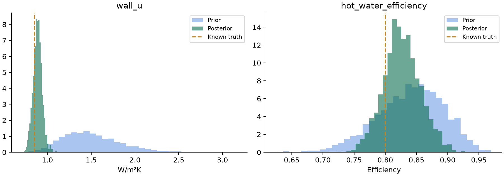
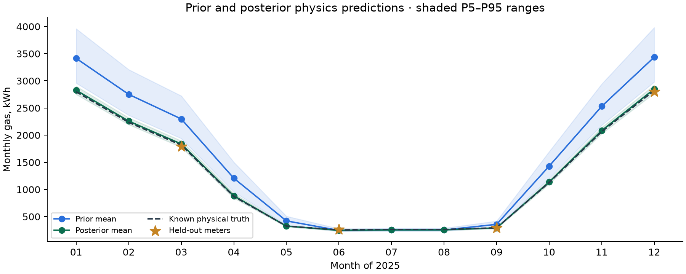

# GreenTwin Bayesian calibration: prior to posterior worked example

**Part 1 · Learn household constants from meters, then rerun the JAX physics twin**  
Team MegaMind · 11 October 2026 · Dedicated worktree: PHYSICS MODEL AND BAYESIAN  
Calibration: `home-calibration/0.1.0` · Physics: `thermal-electricity-fuels/0.3.0`

## 1. What is implemented

The twin now supports the complete requested sequence: initial distributions → Bayesian calibration against household monthly meters → joint posterior constant samples → deterministic physics → final output distributions. The same calibrated household can be used for baseline calculations, what-ifs and retrofit packages.

The implementation uses **NumPyro with the existing JAX physics function inside the likelihood**. NUTS supplies joint MCMC posterior samples and convergence diagnostics. A full-covariance SVI option supplies an explicitly labelled variational approximation. Exact customer facts remain fixed. Missing synthetic inputs remain uncertain and are integrated separately from the inferred constants.

The controlled numerical example demonstrates a **91.01% reduction in held-out monthly gas MAE**. Its annual gas error against the known physical truth falls from **22.91% to 0.82%**. The constants, their distributions, all twelve monthly predictions and the evaluation split are shown below.

**Evidence basis:** this is a controlled synthetic recovery experiment, generated with the same declared physics model plus independent seeded observation noise. It demonstrates calibration and held-out prediction under those conditions. The figures are simulation evidence, rather than a measurement of customer-population accuracy.

## 2. Why calibration changes the output

Before calibration, a building description supplies plausible constants. For example, a wall U-value prior reflects the recorded wall type and eligible population evidence. It does not yet incorporate this household's meter readings. Different plausible constants produce different energy outcomes.

Calibration asks which combinations of constants and unresolved household inputs explain the observed consumption. It updates their probabilities. Final predictions still come from the deterministic physics model, evaluated on those posterior combinations.

`posterior ∝ meter likelihood × initial prior`

Calibration therefore changes the distribution of inputs to the physics engine. It does not overwrite a simulated energy total with the bill or multiply all future predictions by a fitted correction factor. Its output is a joint distribution of plausible physical states, which can also be simulated after a retrofit.

## 3. The statistical model and treatment of uncertainty

Let `theta` contain the selected unknown continuous constants, `z` the remaining jointly generated inputs, and `F(theta, z)` the deterministic JAX twin. For each available monthly meter value:

`meter[m, fuel] ~ StudentT(df=4, location=F(theta,z)[m,fuel], scale=sqrt(5² + (relative_noise × prediction)²))`

The default relative scale is 5% for actual reads and 15% for estimated reads, with a 5 kWh absolute scale floor. The Student-t model is robust to occasional atypical readings. These are scale parameters; for df=4, Student-t SD is scale × √2. Noise settings are configurable and recorded with the fit.

Only supplied training readings contribute likelihood terms. Null readings do not become zero. A supplied zero is an observation. Held-out readings are excluded from inference. The same observation contract supports grid import, mains gas, oil, LPG, solid fuel, district heat, export and PV generation where measurements exist.

The remaining uncertainty uses a frozen bank of jointly generated household realizations. The likelihood is averaged over complete household trajectories:

`log p(meters | theta) ≈ logsumexp(sum_over_observed_months_and_fuels(log p(meter | theta, z[k]))) − log(K)`

Each bank row preserves its geometry, weather, occupancy, demand and equipment dependencies across the whole period. The sum over the observed series happens **before** mixing the rows, preserving one household trajectory across months. This is finite-bank numerical integration, with configurable bank size K.

For final prediction, the code samples `theta` from the posterior and then samples the bank row from `p(z[k] | theta, observed baseline meters)`. It preserves the original half-hour profile seed for that row. Thus unresolved inputs remain uncertain while also reflecting the household's observations. All exact supplied facts stay fixed.

Known absence of PV and a battery permits the identical monthly-demand path inside calibration, because half-hour allocation conserves monthly energy. Installed or uncertain PV/storage uses the complete interval-dispatch path when fitting grid imports. Every final output runs through the full thermal, fuel and half-hour electricity engine.

## 4. Which constants can be calibrated

The default selection considers wall, roof, floor, window and door U-values; ventilation ACH; thermal bridging; heating efficiency/COP; hot-water efficiency/COP; unresolved effective baseload and hot-water demand; and an unknown setpoint. Exact recorded values are excluded automatically.

Additional supported selections include solar gains, retained appliance heat, heating auxiliary power, cylinder-loss multiplier, water temperature rise and battery/inverter performance constants. A parameter must have a nondegenerate initial distribution to be inferred. The existing heat-loss multiplier remains fixed at 1 unless an explicit uncertain prior is supplied; fabric uncertainty is already represented by the individual physical priors.

Calibration preserves dependencies: changing inferred baseload also changes retained internal gains, changing water temperature rise updates water-heating energy, and changing device constants updates the corresponding electrical inputs. Heating and hot-water equipment retain their physical efficiency/COP bounds.

Monthly whole-home meters can constrain combinations of fabric, ventilation and equipment. The joint posterior retains those correlations; it does not assert that every wall or device has been individually measured. Parameters with weak evidence can retain broad distributions.

## 5. Step-by-step execution on a household

1. Validate the household, exact customer facts, requested period and aligned meter observations.
2. Build initial priors using the existing property/context/application-history workflow, or accept an explicitly prepared prior snapshot.
3. Generate and freeze a joint missing-input bank. Calibration itself writes no customer-history observations.
4. Select the requested unknown constants, preserving exact customer and recorded physical values.
5. Construct bounded NumPyro priors and the robust meter likelihood around the JAX twin.
6. Run NUTS or SVI. NUTS adapts during warm-up, then retains posterior draws. Warm-up draws are excluded.
7. Return constant distributions, diagnostics, training/held-out dates, observation counts and provenance.
8. Select joint posterior constant rows and conditional nuisance rows for the desired prediction sample count.
9. Feed those complete realizations to the deterministic physics engine and validate its energy accounting.
10. Return posterior predictive output distributions and joint sample arrays for downstream components.

NUTS checks R-hat, effective sample size, divergences and tree-depth saturation. The default convergence gate requires at least two chains, R-hat ≤ 1.01, effective samples ≥ 50 for each inferred parameter, zero divergences and zero tree-depth-limit hits. A fit failing the gate is labelled `needs_review`; normal posterior prediction is blocked. SVI is labelled `approximate`, with optimization diagnostics and its guide recorded.

## 6. Controlled demonstration: household, meters and split

The SH2 example is a 95 m², two-storey 1970s semi-detached house in BS16 with mains-gas heating. This calibration experiment deliberately fixes all physical quantities except **wall U-value and hot-water efficiency**. That isolates their recovery and makes the numerical comparison interpretable.

| Experiment input | Value |
|---|---|
| Occupants / daytime presence | 4 / part-day |
| Thermostat / heating duration | 20°C / 8 hours per day |
| Known space-heating efficiency | 0.90 |
| Known baseload | 7 kWh/day |
| Known useful hot-water demand | 6 kWh/day |
| Known gas cooking | 1 kWh/day |
| Cylinder / PV / battery | Absent |
| Retained electrical heat fraction | 0.85 |
| Monthly demand multipliers | 1 throughout the year |
| Monthly temperatures, Jan–Dec | 4, 5, 7, 10, 13, 17, 19, 18, 15, 11, 7, 4°C |
| Monthly irradiation, Jan–Dec | 18, 30, 65, 100, 135, 150, 145, 120, 85, 45, 22, 15 kWh/m² |
| Known true wall U-value | 0.85 W/m²K |
| Known true hot-water efficiency | 0.80 |
| Synthetic meter noise | Multiplicative exp(N(0, 0.02²)); seed 731 |
| Training months | January, February, April, May, July, August, October, November |
| Held-out months | March, June, September, December |
| Training observations | 8 gas + 8 electricity = 16 meter values |
| Nuisance bank | 4 rows; other experiment quantities deliberately fixed |
| NUTS settings | 2 chains; 500 warm-up and 1,000 retained draws per chain |
| Total retained joint posterior draws | 2,000 |
| Final physics ensemble | 128 selected realizations per state |

The truth comes from a deterministic run with the declared constants. Noisy monthly readings are generated once. The four held-out months never enter the likelihood. Annual truth is **15,134.12 kWh gas**, useful space heating is **10,828.46 kWh**, and H is **254.10 W/K**.

Initial wall U follows a lognormal with arithmetic mean 1.50 and log-SD 0.22. Initial hot-water efficiency follows a scaled beta over 0.1–1.0 with centre 0.84 and concentration 40. The initial summaries below use 4,096 prior draws; posterior summaries use all 2,000 retained joint draws. The output distributions use 128 realizations, so their sample means need not match a plug-in calculation at the parameter means.

## 7. Initial versus final constants



| Constant | Known truth | Initial mean | Initial SD | Final mean | Final SD | Final P5–P95 |
|---|---:|---:|---:|---:|---:|---:|
| `wall_u` | 0.8500 | 1.4996 | 0.3370 | 0.8881 | 0.0516 | 0.8044–0.9731 |
| `hot_water_efficiency` | 0.8000 | 0.8398 | 0.0536 | 0.8265 | 0.0297 | 0.7774–0.8772 |

| Recovery measure | Wall U-value | Hot-water efficiency |
|---|---:|---:|
| Initial absolute error of mean | 0.6496 | 0.0398 |
| Final absolute error of mean | 0.0381 | 0.0265 |
| Reduction in absolute mean error, % | 94.1310 | 33.3973 |
| Reduction in parameter SD, % | 84.6762 | 44.5670 |


Both known constants lie inside their final 90% credible intervals. Calibration moves both means toward the known values while preserving uncertainty. A final mean is a summary; actual simulation uses joint posterior samples, rather than setting every household realization to that mean.

### All other constant summaries in the demonstration

These quantities were held fixed to isolate the two inferred constants. The table lists the initial and final means recorded in the prepared input artifacts. It distinguishes an inferred change from a quantity preserved by the experiment.

| Constant | Unit | Initial mean | Final mean | Treatment |
|---|---|---:|---:|---|
| `wall_u` | W/m2K | 1.495542 | 0.887012 | Posterior sample subset |
| `roof_u` | W/m2K | 0.400000 | 0.400000 | Fixed experiment input |
| `floor_u` | W/m2K | 0.632000 | 0.632000 | Fixed experiment input |
| `window_u` | W/m2K | 2.800000 | 2.800000 | Fixed experiment input |
| `door_u` | W/m2K | 3.000000 | 3.000000 | Fixed experiment input |
| `air_changes_per_hour` | 1 | 0.660000 | 0.660000 | Fixed experiment input |
| `thermal_bridging_y` | 1 | 0.150000 | 0.150000 | Fixed experiment input |
| `solar_gain_factor` | 1 | 1.000000 | 1.000000 | Fixed experiment input |
| `heat_loss_multiplier` | 1 | 1.000000 | 1.000000 | Fixed experiment input |
| `heating_efficiency` | 1 | 0.900000 | 0.900000 | Fixed experiment input |
| `hot_water_efficiency` | 1 | 0.836235 | 0.825464 | Posterior sample subset |
| `retained_electric_heat_fraction` | 1 | 0.850000 | 0.850000 | Fixed experiment input |
| `heating_auxiliary_power_kw` | kW | 0.040000 | 0.040000 | Fixed experiment input |
| `cylinder_loss_multiplier` | 1 | 1.000000 | 1.000000 | Fixed experiment input |
| `water_temperature_rise_c` | K | 37.000000 | 37.000000 | Fixed experiment input |
| `water_specific_heat_kj_per_kgk` | kJ/kg/K | 4.190000 | 4.190000 | Fixed experiment input |
| `battery_usable_fraction` | 1 | 0.900000 | 0.900000 | Fixed experiment input |
| `battery_charge_efficiency` | 1 | 0.950000 | 0.950000 | Fixed experiment input |
| `battery_discharge_efficiency` | 1 | 0.950000 | 0.950000 | Fixed experiment input |
| `battery_power_c_rate` | 1 | 0.500000 | 0.500000 | Fixed experiment input |
| `inverter_capacity_ratio` | 1 | 1.000000 | 1.000000 | Fixed experiment input |


## 8. Prior versus posterior physics outputs



| Annual physical output | Prior mean | Prior P5–P95 | Posterior mean | Posterior P5–P95 |
|---|---:|---:|---:|---:|
| `gas_kwh` | 18,602.06 | 16,027.25–21,652.51 | 15,257.55 | 14,834.12–15,695.57 |
| `electricity_import_kwh` | 2,671.80 | 2,671.80–2,671.80 | 2,671.80 | 2,671.80–2,671.80 |
| `space_heating_kwh` | 14,043.62 | 11,663.16–16,932.10 | 11,012.80 | 10,583.80–11,416.27 |
| `hot_water_kwh` | 2,190.00 | 2,190.00–2,190.00 | 2,190.00 | 2,190.00–2,190.00 |
| `all_fuel_purchased_kwh` | 21,273.86 | 18,699.05–24,324.30 | 17,929.34 | 17,505.92–18,367.37 |

| Gas distribution statistic | Prior | Posterior |
|---|---:|---:|
| `mean` | 18,602.06 | 15,257.55 |
| `variance` | 3,012,953.28 | 74,208.72 |
| `std` | 1,735.79 | 272.41 |
| `median` | 18,455.30 | 15,277.09 |
| `monte_carlo_standard_error` | 153.42 | 24.08 |


Energy is in kWh; energy variance is in kWh². Electricity and useful hot-water demand stay fixed in this controlled comparison. The inferred wall performance changes useful space heating, and hot-water efficiency changes purchased gas required for the same useful water heat. The prior and posterior mean H values are **308.07 and 257.19 W/K**, against the known **254.10 W/K**.

### Held-out numerical comparison

| Measure on four excluded months | Prior | Posterior |
|---|---:|---:|
| Mean absolute error against noisy meters, kWh | 305.76 | 27.49 |
| RMSE against noisy meters, kWh | 407.56 | 34.07 |
| MAPE against noisy meters, % | 19.86 | 2.58 |
| MAE against known physical truth, kWh | 292.38 | 14.84 |
| Known truth inside physical P5–P95, % | 25.00 | 100.00 |


Held-out MAE falls by **91.01%**. This is measured on months excluded from calibration, providing a stronger check than improvement on the fitted bills alone. Four-month coverage is an example count, rather than a population coverage estimate.

### All twelve monthly gas predictions

| Month | Use | Known truth | Noisy meter | Prior mean | Posterior mean | Posterior P5–P95 |
|---|---|---:|---:|---:|---:|---:|
| 2025-01 | training | 2,798.46 | 2,794.62 | 3,414.17 | 2,827.36 | 2,750.22–2,900.88 |
| 2025-02 | training | 2,235.06 | 2,174.46 | 2,750.89 | 2,258.85 | 2,194.50–2,320.45 |
| 2025-03 | held_out | 1,816.50 | 1,793.71 | 2,298.38 | 1,837.73 | 1,778.07–1,895.85 |
| 2025-04 | training | 870.40 | 877.24 | 1,207.21 | 883.51 | 842.06–925.58 |
| 2025-05 | training | 326.44 | 334.08 | 421.67 | 325.50 | 311.04–339.30 |
| 2025-06 | held_out | 255.00 | 263.35 | 246.41 | 248.31 | 235.56–260.07 |
| 2025-07 | training | 263.50 | 258.50 | 254.63 | 256.59 | 243.41–268.74 |
| 2025-08 | training | 263.50 | 259.49 | 254.63 | 256.59 | 243.41–268.74 |
| 2025-09 | held_out | 294.28 | 292.82 | 357.65 | 291.71 | 279.58–304.32 |
| 2025-10 | training | 1,125.98 | 1,097.92 | 1,429.40 | 1,136.98 | 1,099.90–1,175.28 |
| 2025-11 | training | 2,064.07 | 2,101.15 | 2,530.39 | 2,084.61 | 2,026.87–2,140.85 |
| 2025-12 | held_out | 2,820.92 | 2,800.03 | 3,436.63 | 2,849.82 | 2,772.68–2,923.33 |


### Training, held-out and complete-period error

| Split | Prior MAE, kWh | Posterior MAE, kWh | Prior RMSE, kWh | Posterior RMSE, kWh | Prior MAPE, % | Posterior MAPE, % |
|---|---:|---:|---:|---:|---:|---:|
| training | 297.88 | 24.05 | 375.31 | 35.56 | 20.81 | 1.82 |
| held_out | 305.76 | 27.49 | 407.56 | 34.07 | 19.86 | 2.58 |
| all | 300.50 | 25.20 | 386.36 | 35.07 | 20.50 | 2.07 |


### Physical output ranges versus meter-observation ranges

The distributions used by downstream parts are **physical energy distributions**, obtained by rerunning the twin. They do not include random bill-reading noise. To check a future noisy meter observation, the example separately adds the declared Student-t observation model to each physical realization.

| Held-out month | Actual synthetic meter | Prior meter-predictive P5–P95 | Posterior meter-predictive P5–P95 |
|---|---:|---:|---:|
| 2025-03 | 1,793.71 | 1,907.13–2,757.70 | 1,687.54–2,009.38 |
| 2025-06 | 263.35 | 206.86–296.64 | 213.71–282.89 |
| 2025-09 | 292.82 | 294.69–427.34 | 261.08–335.92 |
| 2025-12 | 2,800.03 | 2,764.34–4,137.77 | 2,615.55–3,120.69 |


## 9. Reusing the posterior for a retrofit or what-if

Calibrate the household once using its actual baseline readings. A hypothetical change then uses that posterior without treating hypothetical consumption as another observation.

`scenario_request(fit, changes)` constructs a proposed state. `predictive_inputs(fit, request=scenario)` selects the same baseline-conditioned latent population as the baseline prediction. Unchanged calibrated components retain their posterior values. An explicit retrofit target replaces the corresponding old value. Replacing heating equipment removes superseded old efficiency facts and uses the proposed technology's initial equipment distribution.

For example, the demonstrated fabric package sets wall U = 0.30, roof U = 0.16 and window U = 1.40 W/m²K. The package replaces the old wall performance while retaining the learned hot-water efficiency. It reruns all edits together.

| Annual quantity | Calibrated baseline mean | Fabric retrofit mean |
|---|---:|---:|
| `gas_kwh` | 15,257.55 | 10,038.14 |
| `electricity_import_kwh` | 2,671.80 | 2,671.80 |
| `space_heating_kwh` | 11,012.80 | 6,315.34 |
| `all_fuel_purchased_kwh` | 17,929.34 | 12,709.94 |


Matched mean gas saving is **5,219.40 kWh/year**, with P5–P95 **4,742.73–5,667.70 kWh/year**. Mean electricity saving is **0.00 kWh/year** in this fabric-only case. Both results carry the same calibration identity, allowing correlated sample-wise savings calculations.

Changing the building state does not imply that old readings describe the modified building. For a real completed retrofit, subsequently collected readings can support a new calibration revision for the new observed state.

## 10. Final output and downstream handoff

Posterior prediction preserves the existing output structure: 16 period-total distributions, 60 monthly output series, seven building-element contributions and their shares, eight metric slots, complete-year summaries, physical conservation checks and full joint sample arrays.

The final result is labelled `uncertainty_basis = posterior_predictive` and `calibration_status = performed`. It includes `calibration_id` and the method/diagnostic status. SVI results also identify their approximate inference status. These fields distinguish a calibrated result from the earlier prior-only workflow.

Use the posterior physics samples for energy, fuel, solar, storage and element diagnostics. Part 2 can calculate signed per-fuel savings, carbon and bills on matched rows; scoring and value components can consume those results and the property state. Preserve each sample's joint relationships when combining quantities.

`shared_calibration.json` additionally exposes the existing shared `CalibrationResult` contract. The complete prepared posterior inputs retain uncertainty in missing inputs and device specifications, alongside the parameter draws. Passing those prepared inputs to `simulate_ensemble` gives the calibrated full-engine results.

Every summary retains mean, variance, SD, median, mode, percentiles, intervals and histogram. Constant-summary Monte Carlo standard errors from NUTS use diagnostic effective sample size. The existing output-summary MCSE uses the finite prediction-ensemble SD/√n convention; inspect sampler ESS separately when assessing inference precision.

## 11. Running it

### Calibrate against household monthly meters

Save a list of nullable monthly observations such as:

```json
[
  {"month": "2025-01", "electricity_import_kwh": 300, "gas_kwh": 2400, "estimated": false},
  {"month": "2025-02", "electricity_import_kwh": null, "gas_kwh": 2100, "estimated": false}
]
```

These two rows illustrate the input format. They are not the numerical demonstration's observations. Import the existing `EnergyUsageMonth` records with `observations_from_usage`, or use the nullable meter columns already in Satyarth's physics handoff.

```sh
.venv/bin/python scripts/run_calibrated_twin.py calibrate --request household.json --meters meters.json --output artifacts/household-calibration
.venv/bin/python scripts/run_calibrated_twin.py predict --calibration artifacts/household-calibration --samples 128 --output artifacts/household-posterior
```

Use `--history` during calibration to read an application-history prior source. Use `--config` to select constants and inference settings. The default method is NUTS; set `method` to `svi` for variational inference. Both store the actual chosen configuration.

### Run a proposed scenario on the saved posterior

```sh
.venv/bin/python scripts/run_calibrated_twin.py predict --calibration artifacts/household-calibration --changes retrofit.json --samples 128 --output artifacts/retrofit-posterior
```

For in-process use:

```python
fit = calibrate_household(request, monthly_observations, prior=initial_prior)
baseline_inputs = predictive_inputs(fit, n_samples=128)
baseline_run = simulate_ensemble(baseline_inputs)

proposed = scenario_request(fit, {"wall_u": 0.30})
after_run = simulate_ensemble(predictive_inputs(fit, request=proposed, n_samples=128))
per_fuel_savings = paired_differences(baseline_run, after_run)
```

The implementation is in `greentwin/bayes/calibration.py`; import the named functions from that module and the ensemble functions from `greentwin/twin/ensemble.py`. The imports are separated from the abbreviated example above for readability.

Calibration artifacts contain the detailed and shared summaries, the aligned joint posterior sample NPZ, frozen nuisance input artifacts and a hash manifest. Prediction artifacts contain prepared posterior inputs and full result artifacts. Replay verifies hashes and does not refit. New output directories are restricted to this worktree.

## 12. Diagnostics, checks and reproducibility

| Sampler/check | Measured result |
|---|---:|
| Fit status | converged |
| Wall-U R-hat | 1.001743 |
| Hot-water-efficiency R-hat | 1.000308 |
| Wall-U effective sample size | 1111.20 |
| Hot-water-efficiency effective sample size | 1105.62 |
| Divergences | 0 |
| Tree-depth-limit hits | 0 |
| Mean NUTS acceptance | 0.946616 |
| Measured calibration duration | 6.21 seconds |
| Largest physical accounting residual, prior/posterior/retrofit runs | 0.00049782 kWh |
| Tests passing across checked physics/input/calibration and shared-contract suites | 128 |
| New calibration tests | 12 |

The twelve calibration tests cover held-out isolation, missing versus zero readings, observation alignment, exact-fact preservation, dependent gains, NUTS recovery, posterior replay and tamper detection, posterior retrofit pairing, diagnostic gating, Satyarth handoff, SVI, conditional nuisance sampling, equipment replacement and differentiable PV/battery grid-import likelihood.

The measured fit duration describes this controlled two-constant example and its settings. It is not a latency guarantee for other household sizes, bank sizes or installed equipment.

Reproduce the experiment in a new directory:

```sh
.venv/bin/python scripts/evaluate_bayesian_calibration.py --output eval/reports/new-bayesian-example --warmup 500 --samples 1000 --predictive-samples 128
```

Evidence SHA-256: `cb28e01c4f8c9797fedb46ccf1cb392847bc98de0b50d5cfd4901bd50d1d4920`.

- [Full numerical evidence](../eval/reports/bayesian_calibration_final/evidence.json)
- [Example household](../eval/reports/bayesian_calibration_final/request.json)
- [All noisy meters with training flags](../eval/reports/bayesian_calibration_final/meters.json)
- [Initial priors and frozen nuisance bank](../eval/reports/bayesian_calibration_final/calibration/nuisance_inputs/priors.json)
- [Detailed calibration and before/after constants](../eval/reports/bayesian_calibration_final/calibration/calibration.json)
- [Shared calibration contract](../eval/reports/bayesian_calibration_final/calibration/shared_calibration.json)
- [All 2,000 joint posterior constant draws](../eval/reports/bayesian_calibration_final/calibration/posterior_samples.npz)
- [Prior physical outputs](../eval/reports/bayesian_calibration_final/prior/result.json)
- [Posterior physical outputs](../eval/reports/bayesian_calibration_final/posterior/result.json)
- [Prepared posterior input distributions](../eval/reports/bayesian_calibration_final/posterior_inputs/inputs.json)
- [Joint posterior physics output draws](../eval/reports/bayesian_calibration_final/posterior/output_samples.npz)
- [Posterior-based retrofit result](../eval/reports/bayesian_calibration_final/retrofit/result.json)

Method references: [NumPyro MCMC and NUTS](https://num.pyro.ai/en/latest/mcmc.html), [NumPyro SVI](https://num.pyro.ai/en/latest/svi.html).
