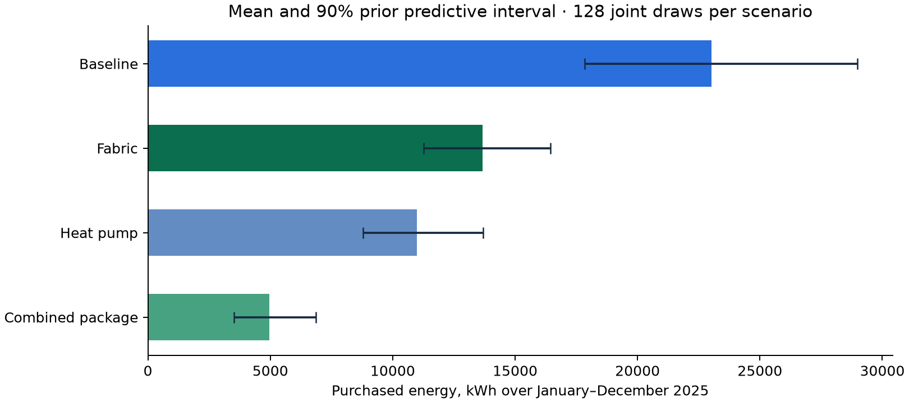
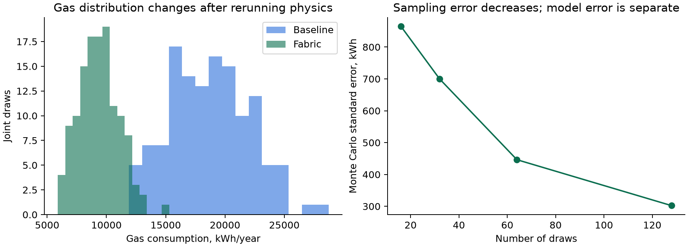

# GreenTwin · Part 1 implementation and evidence report

**Physics, missing household inputs and initial uncertainty**  
Team MegaMind · Dedicated worktree: PHYSICS MODEL AND BAYESIAN  
Evaluation date: 11 October 2026 · Physics model: thermal-electricity-fuels/0.3.0

## Executive assessment

The requested three-stage implementation is complete: separate initial prior construction, separate joint synthetic missing-input generation, and deterministic JAX simulation wrapped in Monte Carlo output distributions. Gas and other supported purchased fuels are accounted for alongside electricity. **Bayesian calibration has not been implemented or called.**

The measurable gains are better representation of uncertainty, traceable input handling and reproducible fuel/retrofit accounting. This report does not claim an improvement in real-world prediction accuracy. The currently available local priors, appliance centres and development weather are provisional; this phase cannot establish the system design's meter-accuracy or held-out coverage targets.

* **115 tests pass**, including the new uncertainty-boundary tests and the existing thermal, electricity and synthetic-data tests.
* **128/128 fabric scenario draws** reduce or preserve useful heating in this evaluation.
* The largest checked conservation residual across the four annual scenarios is **0.003273 kWh**. This is a numerical identity check, not prediction error against meters.
* Supplying seven envelope measurements reduces heat-loss-coefficient sample SD by **88.26%** in this experiment.
* Regenerating the same request and seed returns identical parameter arrays: **True**.

## What changed compared with the preceding implementation

| Aspect | Previously available | Added in this phase |
|---|---|---|
| Physics | Deterministic monthly thermal and half-hour electricity engine | Prior-predictive ensemble wrapper over the same JAX solver |
| Missing inputs | Development household/profile generators | Explicit bounded probability models and conditional joint input draws |
| Constants | Default/supplied scalar values | Separate source-labelled initial probability distributions |
| Customer facts | Deterministic intake/handoff | Frozen exact facts throughout the ensemble; unknown input rejection |
| Fuels | Six fuel carriers already supported | Monthly fuel-by-end-use summaries, sampled efficiencies and separate auxiliaries |
| Uncertain outputs | Conditional deterministic electricity runs | Mean, variance, SD, intervals, histograms, joint raw samples and MCSE |
| Replay | Seeds and older development artifacts | Hash-verified prepared inputs, separate simulation stage and saved output draws |
| Evaluation | 90 preceding tests | 115 total tests plus the measured scenario artifacts below |

This is completion of the user's requested phase, not completion of every item assigned to Part 1 in SYSTEM_DESIGN.pdf. Calibration, scene/capture, standard SAP preparation, public data fitting and full app/orchestrator integration remain outside this phase.

## Evaluation design and comparability

The showcase SH2 home is a 95 m², two-storey semi-detached house in BS16. The request fixes four occupants, a 20°C thermostat, gas cooking at 1 kWh/day and no hot-water cylinder. Existing PV/battery absence is explicit in its Property. Fabric descriptions, ventilation, efficiency, geometry detail, demand factors and development weather remain uncertain where not measured.

Each scenario has **128 draws**, seed **42**, and the same twelve months of 2025. The annual electricity calculation has **17,520 half-hour intervals per draw**, so the four principal scenario runs cover **512 household realizations** and **8,970,240 dispatch intervals**. These counts describe computation, not independent observed households. Named random streams preserve the same latent draws for unaffected quantities, improving the precision of paired scenario comparisons.

The fabric scenario supplies wall U=0.30, roof U=0.16 and window U=1.40 W/m²K. Heat-pump-only changes the equipment/fuel without changing the fabric. The combined scenario applies those fabric edits, an air-source heat pump, 3.5 kWp PV and a 5 kWh battery in a single rerun. Their feasibility, installation costs and appropriateness for this household have not been established by this simulator.

## Annual scenario results

All values below are simulation estimates for the complete 2025 calendar year. SD is household/model uncertainty under the declared priors. Variance has units kWh². The interval is the empirical 5th–95th percentile range of the joint realizations.

| Scenario | Gas mean, kWh | Grid import mean, kWh | All-fuel mean, kWh | SD, kWh | Variance, kWh² | 90% interval, kWh |
|---|---:|---:|---:|---:|---:|---|
| Baseline gas home | 18,706.0 | 4,307.8 | 23,013.8 | 3,404.3 | 11,588,959 | 17,843.2–28,973.3 |
| Fabric changes | 9,352.0 | 4,307.8 | 13,659.8 | 1,719.1 | 2,955,395 | 11,264.7–16,434.8 |
| Heat pump only | 365.0 | 10,620.7 | 10,985.7 | 1,525.9 | 2,328,224 | 8,777.9–13,685.7 |
| Fabric + heat pump + PV + battery | 365.0 | 4,602.1 | 4,967.1 | 1,024.9 | 1,050,328 | 3,506.9–6,857.9 |



The combined scenario's mean purchased energy is **78.42%** below the baseline mean in this development experiment. This ratio of scenario means is descriptive; it is not the mean of per-draw official improvement-potential ratios, and it is not a guaranteed saving.

## Signed per-fuel changes and interactions

The following numbers are the means of **paired baseline-minus-after samples**. Positive means a reduction; negative means an increase. They must remain separate before applying carbon factors or prices.

| Scenario | Gas saving, kWh | Electricity saving, kWh | All-fuel saving, kWh |
|---|---:|---:|---:|
| Fabric changes | 9,354.0 | 0.0 | 9,354.0 |
| Heat pump only | 18,341.0 | -6,312.9 | 12,028.1 |
| Fabric + heat pump + PV + battery | 18,341.0 | -294.2 | 18,046.7 |

The heat-pump-only scenario reduces heating gas while raising electricity import; the remaining gas is cooking. The combined package is rerun as one changed household. Its effect is not an addition of independent fabric, heating, PV and battery savings. Full paired distributions, including variance and intervals, are saved in evidence.json.

## Numerical evidence and what it proves

Conservation checks run on **every realization** before output summarization. They test the monthly heat balance, purchased fuel versus delivered heat/conversion losses, heat-pump ambient heat, monthly allocation and half-hour electricity/PV/battery identities, including storage bounds and power limits. Ordinary float32 rounding gives small nonzero residuals.

All six fuel configurations are independently checked in January on eight draws each. The conversion error compares the reported main heating fuel input with useful heating divided by the separately sampled efficiency/COP. The retained gas cooking is 31 kWh in every non-gas-heating January case.

| Main fuel | Mean all-fuel purchase in January, kWh | Max conversion identity error, kWh | Mean gas incl. cooking, kWh |
|---|---:|---:|---:|
| mains_gas | 3,695.5 | 0.000741 | 3,347.1 |
| oil | 3,867.3 | 0.000662 | 31.0 |
| lpg | 3,695.5 | 0.000741 | 31.0 |
| solid | 5,081.9 | 0.000862 | 31.0 |
| district | 3,467.1 | 0.000644 | 31.0 |
| electricity | 1,509.9 | 0.000067 | 31.0 |

This evidence supports algebraic correctness and physical accounting. It does not prove that a particular actual home's U-values, demand behaviour or seasonal COP equal the current priors. Synthetic-target agreement is method validation rather than observed accuracy, consistent with LLOYDS-ps2.pdf §9 and §11.

## Measured uncertainty improvement

Fixing wall, roof, floor, window and door U-values, ACH and the thermal-bridge coefficient to supplied envelope values changes the sample SD of H from **33.541 W/K** to **3.937 W/K**, a **88.26% reduction**. Residual geometry uncertainty remains. This is a controlled demonstration that extra information narrows this diagnostic; it is not evidence that all output intervals always shrink after any customer answer.

Repeated requests reproduce arrays exactly. Changing the random seed changes uncertain quantities. Changing a supplied U-value keeps the unaffected latent streams shared. Exact values such as the customer thermostat or measured wall U have zero input variance, while their simulated energy consequences can retain uncertainty from other inputs.



## Sample count, convergence and runtime

The table uses nested prefixes of the baseline ensemble, not separate empirical datasets. MCSE estimates the error in the Monte Carlo mean as sample SD divided by square root of sample count. It is different from the household uncertainty SD and from model bias.

| Draws | Baseline gas mean, kWh/year | Mean MCSE, kWh/year |
|---|---:|---:|
| 16 | 18,743.0 | 865.1 |
| 32 | 19,083.3 | 700.0 |
| 64 | 19,111.3 | 446.4 |
| 128 | 18,706.0 | 302.2 |

Increasing the sample count reduces sampling error but cannot recover missing evidence or correct wrong structural assumptions. At 128 samples, fine tail probabilities and rare ownership states remain imprecise. Production sample counts should reflect the required decision precision.

| Scenario | Ensemble wall time, seconds |
|---|---:|
| Baseline gas home | 14.41 |
| Fabric changes | 13.35 |
| Heat pump only | 16.74 |
| Fabric + heat pump + PV + battery | 12.66 |

Times include interval preparation, JAX dispatch, validation and distribution summarization on this machine, with batch size eight. Initial runs include compilation where necessary; later runs may reuse kernels. These are measured end-to-end development times, not a promise of subsecond application latency or calibration performance.

## Outputs ready for downstream parts

The baseline result has **16 scalar total/storage summaries**, **60 monthly series**, **seven element contributions and shares**, and **eight metric entries**. A metric may be unavailable when its denominator is zero; for example, self-consumption is undefined for a known no-PV baseline. Stocks such as initial/final battery energy are not added to purchased-energy totals.

Part 2 receives joint per-fuel energy samples, separate gas/electricity changes, PV import effects, end-use splits and heat-loss diagnostics. It must apply source-valid tariffs/factors to these same draws and compute ratios/savings with the required zero-baseline handling. Parts 3 and 4 still own the Green Home Score and indicative property value. The scene adapter uses estimated element loss shares; it must preserve their estimated/prior-based status. No solar score, carbon number, property value or official recommendation is manufactured by this phase.

## Important limitations and next handoff

1. **No posterior:** meters are not consumed in a likelihood; no NumPyro fitting, NUTS, SVI or recalibration is performed.
2. **Provisional evidence:** local RdSAP-style defaults and catalogue estimates require verification. No verified NEED or local empirical fit is bundled here. `ContextRecord` accepts documented eligible cohorts but does not download or validate their source licences automatically.
3. **Model resolution:** single-zone monthly steady-state heat, fixed 3 K setback and approximate gains; half-hour electricity allocation is not a transient room-temperature model. Seasonal COP does not model defrost/startup dynamics.
4. **Incomplete uncertainty:** party-wall and other structural assumptions can be exact assumptions rather than sampled epistemic uncertainty. A tight output interval is not proof that those assumptions are correct.
5. **Fuel scope:** gas means mains-gas purchased thermal energy. There is no gas pressure network, combustion chemistry or pollutant concentration simulation.
6. **Feasibility boundary:** the simulator calculates a supplied supported scenario; the rules/survey layer must decide whether it can be installed. Partial periods are not automatically annualised.
7. **Integration boundary:** this new ensemble contract supplements schema 0.4. Full shared DigitalTwin Protocol/UI bindings, SAP standard mode, scene/capture and downstream score/value are still required separately.
8. **Empirical targets not achieved yet:** showcase ±15% metered accuracy and 90% held-out interval coverage from SYSTEM_DESIGN.pdf cannot be certified by these development experiments.

## Reproduction and artifacts

The evidence script is `scripts/evaluate_uncertain_twin.py`; report generation is `scripts/build_twin_report.py`. Run from this worktree with its Python environment. Use a **new** output directory when rerunning.

```sh
.venv/bin/python scripts/evaluate_uncertain_twin.py --samples 128 --output eval/reports/new-run
.venv/bin/python scripts/build_twin_report.py --evidence eval/reports/new-run/evidence.json --test-count 115
.venv/bin/python -m pytest -q --basetemp .pytest_tmp
```

The prepared directory contains request/priors/input summaries, input NPZ and a hash manifest. Each scenario directory contains result JSON, output NPZ and metrics/file hashes. The evidence JSON holds scenario summaries, paired changes, convergence, information gain and fuel checks. All reports/charts and runtime caches remain inside this worktree. The original main checkout and Satyarth branch are untouched.

Report dependencies: matplotlib, Markdown and reportlab; PDF reading used pypdf. Core runtime dependencies remain JAX, NumPy, SciPy and Pydantic. Report rendering libraries do not participate in the physics calculation.

## Technical appendix: implementation, input audit and usage

#### Detailed implementation reference

This implementation covers the requested three layers and gas/fuel accounting. It does **not** perform Bayesian calibration. Outputs describe a conditional **prior predictive** distribution, not a meter-calibrated posterior or a guarantee.

### 1. The boundary between the layers

1. `build_priors(HouseholdRequest) -> PriorBundle` constructs initial distributions for unknown inputs and constants. It uses property descriptors, local provisional defaults, the appliance catalogue and eligible supplied population/context records. It does not run JAX or fit to this household's meters.
2. `generate_missing_inputs(request, n_samples, prior=...) -> InputSamples` draws a joint set of physically bounded household realizations. It computes dependent geometry, gains, water demand and monthly profiles. It imports no JAX. `prepare_electricity_sample` supplies a reproducible interval realization outside the physics solver; preparation is lazy to bound memory.
3. `simulate_ensemble(InputSamples) -> EnsembleRun` passes numeric realizations to the deterministic JAX solver using `jit` and `vmap`. Every realization passes thermal/fuel and interval conservation checks. It summarizes joint output samples using the shared `contracts.summarise`, with additional explicit variance and Monte Carlo standard error.

The solver contains no random-number generation. Constants remain fixed throughout one realization. Prepared artifacts can be saved and replayed without rebuilding priors. The separate legacy synthetic **label** generator in `generate.py` is a different purpose: it creates development training/evaluation tables using physics. Agreement against those labels is not empirical household accuracy.

### 2. Input audit and the customer experience

The read-only Satyarth handoff supplies geometry, fabric defaults and their sources, heating equipment, occupancy/presence, heating periods, appliance answers and summaries, hot-water configuration, monthly weather and profiles. It includes meter and prior suggestions, which this phase deliberately does not use for calibration. A cached SH2 handoff and a versioned copy of its appliance catalogue are available locally. Catalogue consumption is an estimated centre, not a measured customer fact.

There is no separate local Satyarth worktree: Git currently lists the main checkout and this dedicated worktree. The Satyarth code/handoff was inspected read-only; no branch was checked out or modified.

| Input | Treatment now | Easy question if unavailable |
|---|---|---|
| Location, total floor area, property type, heating equipment | Property/handoff or explicit facts; essential for a new home | Postcode district, approximate total area, house/flat, main heating type |
| Construction age and built form | Property descriptors; otherwise uncertain development archetype | Approximate building era; detached/semi/terrace |
| Occupants and daytime presence | Exact when answered; categorical distributions otherwise | How many people? Mostly home/part day/out all day? |
| Thermostat and heating periods | Exact when answered; bounded distributions otherwise | Typical temperature and approximate heating hours |
| Existing PV and battery | Explicit capacity/absence preserved; unknown ownership is a labelled mixture | Do you already have solar or a battery? Capacity if known |
| Cooking fuel | Exact when answered; conditional mixture otherwise | Gas or electric hob/oven? |
| Cylinder and flat exposure | Exact when answered; unknown state is a mixture | Hot-water tank? Ground/middle/top flat? |
| Appliances | Questionnaire catalogue supplies centres with uncertain demand multipliers | Optional simple appliance selections; avoid model numbers |
| U-values, air changes, efficiencies, geometry detail | Bounded priors; supplied physical measurements stay exact | No technical survey questions required initially |
| Weather and half-hour load/PV series | Supplied series, or explicitly enabled development approximation | Obtain from data service, not the customer |
| Local population evidence | Explicit `ContextRecord` rows, with provenance and cohort filters | Obtain licensed data through Part 0 |

The minimum for a home without `Property`/handoff is four basic facts. Zero facts cannot identify a building, location or fuel system. Unknown fields fail explicitly instead of being ignored. `None` means missing. A numerical zero or a boolean false is an explicit answer. `floor_area_m2` means **total dwelling floor area**; use `exposed_floor_area_m2` for a surveyed external-floor area. A supplied `Property`'s explicit renewable zero is treated as a known absence.

### 3. Available evidence and probability assumptions

The local RdSAP-style defaults are marked `to_verify`; the appliance catalogue contains typical estimates. Verified NEED microdata, local cohort fits, London learned archetypes and PVGIS simulations are **not** present in this checkout. The program does not pretend to have fitted them. Development weather is opt-in, and its uncertainty is propagated. Public/local data can replace a prior through `context`; population evidence is separate from future meter calibration.

Each `PriorMarginal` records family, centre, scale, physical bounds, unit, source, rationale and role. Numeric summaries also retain their joint sample arrays. Categorical missing inputs have probabilities, not invented fractional people or averaged equipment states.

| Quantity | Initial family | Domain / meaning |
|---|---|---|
| Fabric U-values | Lognormal, log-SD 0.22 | Positive; exact observed U-values freeze |
| Ventilation ACH | Lognormal, log-SD 0.25 | 0.1–3 per hour |
| Thermal bridges | Lognormal, log-SD 0.25 | 0.001–0.5 W/m²K |
| Combustion/district efficiency | Scaled beta, concentration 45 | 0.1–1; cannot create heat from fuel |
| Heat-pump seasonal COP | Lognormal, log-SD 0.12 | 1–7; ambient heat is reported separately |
| DHW efficiency / COP | Beta 40 or lognormal 0.15 | Selected by equipment/fuel; direct electric is 1 |
| Setpoint / heating hours | Bounded normal | 10–28°C / 0–24 h/day |
| Geometry aspect, volume, opening factors | Lognormal | Coupled geometry, positive bounded factors |
| Appliance, lighting, water demand factors | Lognormal | Log-SD 0.25 / 0.20 / 0.22 |
| Retained appliance heat | Scaled beta | 0.05–0.999; does not create electricity |
| Pump/fan electrical power | Lognormal | 0.005–0.2 kW |
| Water temperature rise | Bounded normal, 37 ± 3 K | 20–55 K; water heat capacity is 4.19 kJ/kg/K |
| Development monthly temperature / GHI | Bounded normal / lognormal | SD 1.5°C / log-SD 0.15, temporal copula |
| Monthly baseload / DHW factors | Correlated lognormal | AR(1) rho 0.65; exact supplied profiles freeze |
| PV azimuth / tilt / yield | Bounded normal / lognormal | 0–360° / 0–90° / positive yield multiplier |
| Battery usable fraction / efficiencies | Scaled beta | Each less than 1; capacity and power limits apply |

These widths are explicit development choices, not experimentally established confidence. Structural assumptions (adiabatic equal-temperature party wall, 3 K setback, fixed solar-aperture factor, zero initial battery unless supplied) remain model assumptions. Not every source of model error is represented by the ensemble.

For a matching numeric population cohort of n rows and age a years, the initial pooling weight is `n/(n+20) * exp(-a/10)`. The prior mean blends the fallback and cohort mean; variance includes a heterogeneity floor and between-mean disagreement. The most geographically specific eligible recent cohort is selected for each variable, avoiding overlap between district and parent-region aggregates. Future, held-out, same-home and mismatched cohorts are excluded and audited. This is initial prior construction, not a meter-likelihood update. Row counts must mean actual population observations; do not submit repeated aggregate means as independent households.

### 4. Physics and dependencies

Heat-loss coefficient is `H = sum(U*A) + y*exposed_area + 0.33*ACH*volume`, in W/K. The monthly steady-state calculation has occupied and 3 K setback balances and subtracts internal/solar gains, clipping useful heating at zero. Unused gains are explicit. This is a single-zone resistance model; it has no transient capacitance or room-temperature trajectory.

Geometry draws share a footprint/perimeter factor and opening factor. Floor area and storeys determine footprint; ground/top-flat exposure is sampled only if unknown. Appliance energy and retained internal gains share the same realization. Water demand uses `mass * heat_capacity * temperature_rise / 3600`; electric shower energy is removed from the main hot-water load to avoid counting it twice. Pump/fan electricity, outdoor loads and secondary electric heat are separate.

Space heating and DHW are converted independently by the selected efficiency/COP. For combustion: purchased fuel = useful heat + conversion loss. For heat pumps: purchased electricity + ambient heat = delivered heat. Supported purchased energy carriers are grid electricity, mains gas, oil, LPG, solid fuel and district heat. Gas cooking remains when gas heating is replaced. This models **fuel energy**, not gas pressure/pipe flow, concentrations, litres, fuel mass or combustion chemistry.

Half-hour electricity dispatch accounts for demand, PV, direct PV consumption, imports, exports, charging, discharging, storage losses, curtailment and continuous state of charge. Power/capacity/export limits are enforced. Solar reduces grid imports rather than the underlying household demand. Monthly heating is allocated to half-hour profiles; an hourly temperature response or weather-dependent defrost COP is not inferred from that allocation.

### 5. Outputs and downstream handoff

Every available uncertain numeric summary includes mean, variance, SD, median, mode, percentiles, 50% and 90% intervals, histogram, skewness, sample count and `std/sqrt(n)` Monte Carlo standard error. The shared field name `credible_intervals` is retained for compatibility; here it means a **prior predictive** interval, not a calibrated posterior interval. Numeric inputs that are exact have zero variance; deterministic outputs can still be uncertain because other inputs are missing.

* Period totals and monthly trajectories: useful space heating, hot water, fuel input, conversion losses and ambient heat; electricity demand/import/export, PV and battery accounting; six-carrier totals and fuel-by-end-use breakdowns.
* Two purchased-energy conventions: `purchased_electricity_gas_kwh` implements the Lloyds grid-import-plus-gas definition. `all_fuel_purchased_kwh` additionally includes oil/LPG/solid/district energy. Downstream code must select the intended convention explicitly.
* Envelope diagnostics: H, thermal bridges and seven element contributions/shares. These are estimates from the parameter realization, not independently calibrated element losses.
* Electricity diagnostics: peak import, import fraction between 16:00 and 19:00 local time, self-consumption, self-sufficiency, initial/final stored energy. A ratio undefined in any realization returns `null` with reason rather than dropping those realizations.
* Full joint output draws in NPZ, enabling correlated per-fuel savings/carbon/bill calculations. Optional interval arrays are large; request them only when needed.
* Full-calendar-year totals only when all twelve months of that year are present. Partial periods remain partial; no automatic multiplication by twelve.
* Input distributions, prior/context audit, sources/warnings, request hash, seed, model/data versions, conservation residuals, `physics_l1` provenance, and explicit `calibration_status=not_performed`.

`paired_differences` reruns baseline and after scenarios with named common random streams and returns signed baseline-minus-after distributions per carrier. Negative electricity saving is preserved. Packages rerun the combined edits; individual savings are never added. This utility does not rank feasible recommendations or calculate the official improvement potential.

Part 2 can apply sourced date-valid prices and emissions factors **to the same paired draws**, calculate purchased-energy improvement potential with zero-baseline handling, estimate ratings in the appropriate standard mode, and rank feasible packages. Parts 3 and 4 combine those results with recorded/estimated rating and property state for the Green Home Score and indicative value. The scene owner can map estimated element shares to surfaces. Scores, carbon, bills and value are explicitly unavailable in this new Part-1 result; there is no fabricated solar score. Shared `DigitalTwin` orchestration/scene adapters remain a separate integration task; this ensemble contract does not change schema 0.4 or the generated TypeScript mirror.

### 6. Running and replaying

From `PHYSICS MODEL AND BAYESIAN`, a minimal request JSON is:

```json
{
  "property_id": "HOME-001",
  "user_inputs": {
    "postcode_district": "BS16",
    "floor_area_m2": 95,
    "property_type": "house",
    "heating_system": "gas_boiler_combi",
    "occupants": 3,
    "thermostat_c": 20,
    "has_solar_pv": false,
    "has_battery": false,
    "cooking_fuel": "mains_gas"
  },
  "months": ["2025-01", "2025-02"],
  "seed": 42,
  "allow_development_weather": true
}
```

Save a request **inside this worktree**, then:

```sh
.venv/bin/python scripts/run_uncertain_twin.py prepare --request request.json --samples 128 --output artifacts/home001-inputs
.venv/bin/python scripts/run_uncertain_twin.py simulate --prepared artifacts/home001-inputs --output artifacts/home001-result
```

Prepare writes request, initial priors, input summaries, joint input NPZ and a SHA-256 manifest. Simulate verifies hashes and reuses those inputs. Every output directory must be new and inside this worktree. To try a scenario, modify the facts and prepare a new revision with the same identity, seed and sample count. `--changes` accepts a JSON object of simple facts. Neither existing artifacts nor other worktrees are overwritten.

```sh
.venv/bin/python scripts/run_uncertain_twin.py run --demo SH2 --samples 128 --output artifacts/sh2-example
.venv/bin/python scripts/evaluate_uncertain_twin.py --samples 128 --output eval/reports/new-evidence
.venv/bin/python -m pytest -q --basetemp .pytest_tmp
```

The convenience `run` command stores outputs and their input/prior summaries; use **prepare then simulate** to retain the complete input artifact for direct replay. Sample count is configurable from 2 to 10,000, with default 128 and batch size 8. More draws reduce Monte Carlo error; they do not fix inaccurate priors or missing physics. The largest runs can take substantial time. Change batches for memory/performance without changing the intended sample population.

### 7. Remaining work beyond this request

Verified local datasets, learned load archetypes, PVGIS weather/PV integration and empirical validation come next. Then Bayesian calibration can replace initial uncertain parameter samples with constrained posterior samples through the deterministic seam. Standard-occupancy/SAP preparation, full `DigitalTwin` Protocol integration, capture/scene wiring and downstream rating/score/bills/carbon/value completion remain separate. The system-design goals of ±15% showcase meter agreement and 90% held-out coverage have not been demonstrated by this prior-only phase.

